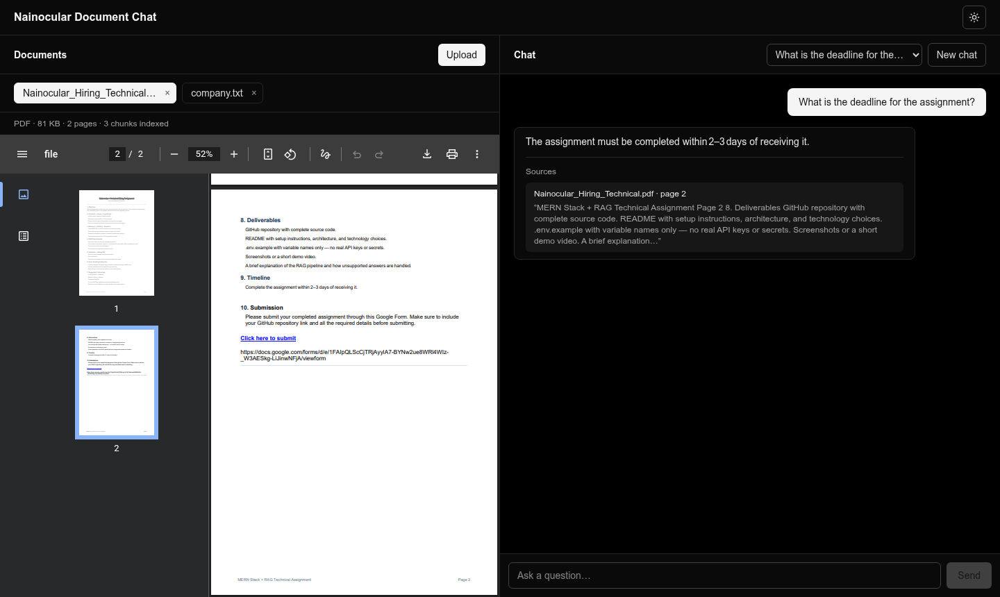
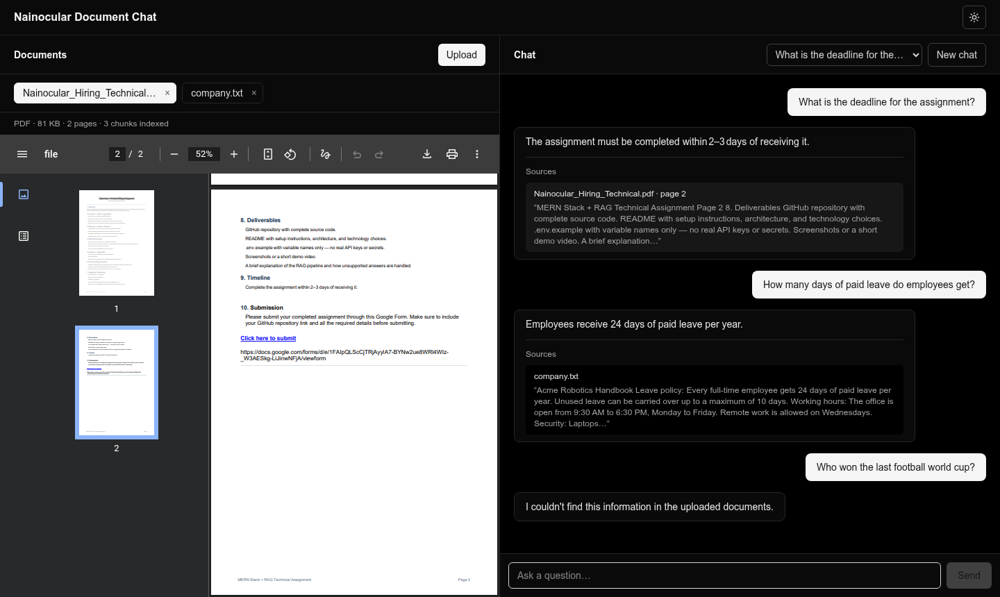
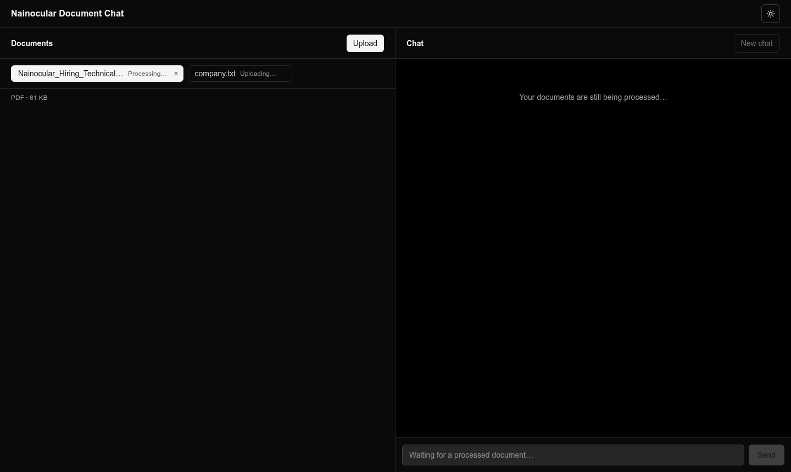
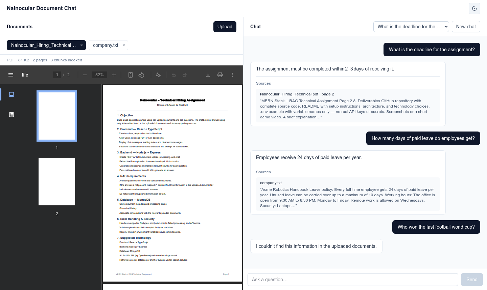

# Nainocular Document Chat

A web app where you upload PDF or TXT documents and ask questions about them. Answers come **only** from the uploaded documents, and each answer shows the document, page and text excerpt it came from. If the documents don't contain the answer, the bot replies exactly:

> I couldn't find this information in the uploaded documents.

Built with React + TypeScript, Node.js + Express, MongoDB with vector search, and free models on OpenRouter.



## Demo video

https://github.com/user-attachments/assets/6f6c4412-27e6-47c9-90df-9980a0df5703

A 2 min 20 s walkthrough. It shows how to start MongoDB, the server and the client, then uploads a PDF, asks questions, opens a cited page, triggers the fallback reply, reloads to show the saved chat history, and switches the theme.

---

## Contents

- [Demo video](#demo-video)
- [Features](#features)
- [Tech stack](#tech-stack)
- [Architecture](#architecture)
- [The RAG pipeline](#the-rag-pipeline)
- [How unsupported answers are handled](#how-unsupported-answers-are-handled)
- [Setup](#setup)
- [Environment variables](#environment-variables)
- [API](#api)
- [Error handling and security](#error-handling-and-security)
- [Limitations and next steps](#limitations-and-next-steps)
- [Screenshots](#screenshots)

---

## Features

- **Upload PDF or TXT files** with the button or by drag and drop. Files are checked in the browser and again on the server.
- **Processing status** for every document: Uploading… → Processing… → ready, or Failed with the reason.
- **Chat over all ready documents.** Answers are cited, and every source shows the document name, page number and an excerpt.
- **Click a source** to open that document at the cited page.
- **Chat history** is stored in MongoDB. Follow-up questions stay in the same conversation, past conversations can be reopened, and the open chat survives a page reload.
- **Document viewer** next to the chat, showing the original PDF (fit to width, with the file name in the toolbar) or text.
- Light and dark theme, and a responsive layout (side by side on desktop, stacked on small screens).

## Tech stack

| Layer | Choice | Why |
|---|---|---|
| Frontend | **React 19 + TypeScript, Vite, Tailwind CSS v4** | Vite gives a fast dev server and a plain single-page app, so all backend logic stays in Express. |
| Backend | **Node.js 24 + Express 5 + TypeScript** | As the brief asks. Express 5 sends errors from async handlers to the error middleware automatically. |
| Database | **MongoDB + Mongoose** | Stores documents, chunks with their embeddings, conversations and messages. |
| Vector search | **MongoDB `$vectorSearch`** (local `mongodb-atlas-local` Docker image) | Vectors live next to the data in one database, so there's no separate vector service. A plain-`mongod` fallback is included (see `VECTOR_SEARCH`). |
| LLM | **`nvidia/nemotron-3-super-120b-a12b:free`** through OpenRouter, with automatic fallback models | The best free model in testing: fast, accurate, and it returns the exact fallback sentence. |
| Embeddings | **`nvidia/nemotron-3-embed-1b:free`** through OpenRouter | Free, and the same API key as the LLM. |
| PDF parsing | **unpdf** (pdf.js) | Extracts text **per page**, so answers can cite page numbers. |
| Validation and security | **zod, multer, helmet, cors, express-rate-limit** | Validates requests and uploads, sets security headers and limits requests to the AI endpoints. |

The OpenAI SDK is used as the HTTP client, pointed at OpenRouter's OpenAI-compatible API. No LangChain: every step of the pipeline is a small file in `server/src/services/`, so it is easy to read and explain.

## Architecture

```
┌──────────────────────────┐   /api (Vite proxy in dev)   ┌───────────────────────────────┐
│  React client (:5173)    │ ───────────────────────────▶ │  Express API (:5000)          │
│  DocumentViewer│ChatPanel │ ◀─────────────────────────── │  routes → services            │
└──────────────────────────┘          JSON                └──────┬───────────────┬────────┘
                                                                 │               │
                                                   documents, chunks,      embeddings + chat
                                                   vectors, chat history   completions
                                                                 ▼               ▼
                                                   ┌─────────────────────┐ ┌──────────────┐
                                                   │ MongoDB (Docker)    │ │  OpenRouter  │
                                                   │ + $vectorSearch     │ │  free models │
                                                   └─────────────────────┘ └──────────────┘
```

```
.
├── docker-compose.yml          # local MongoDB with vector search
├── client/                     # React + TypeScript (Vite)
│   └── src/
│       ├── api.ts              # typed fetch wrappers; server errors → readable messages
│       ├── hooks/              # useDocuments (upload, status polling), useChat (history), useTheme
│       └── components/         # DocumentViewer, ChatPanel, ThemeToggle
└── server/                     # Express + TypeScript
    ├── uploads/                # original files, for the viewer (git-ignored)
    └── src/
        ├── config/             # env validation (zod), MongoDB connection
        ├── models/             # Document, Chunk, Conversation, Message
        ├── middleware/         # upload checks, id validation, central error handler
        ├── routes/             # documents, chat, conversations
        └── services/
            ├── extract.ts      # PDF/TXT → text per page
            ├── chunk.ts        # recursive text splitter
            ├── embed.ts        # batched embeddings
            ├── retrieve.ts     # vector search + similarity cutoff
            ├── llm.ts          # grounded prompt, citations, fallback detection
            ├── chat.ts         # the question → answer flow
            ├── process.ts      # background ingestion job
            └── storage.ts      # original files on disk
```

**MongoDB collections**

| Collection | Holds |
|---|---|
| `documents` | Name, type, size, `status` (`processing` / `ready` / `failed`), `error`, page and chunk counts |
| `chunks` | `documentId`, document name, page, chunk text and `embedding` (has the vector index, filtered by `documentId`) |
| `conversations` | Title and the `documentIds` the conversation used |
| `messages` | `conversationId`, role, content and, for answers, the `sources` |

## The RAG pipeline

### 1. Ingestion (when a file is uploaded)

1. **Validate.** Only `.pdf` and `.txt`, max 10 MB, not empty. The server also checks the bytes: a PDF must start with `%PDF-`, and a TXT must be valid UTF-8 text.
2. **Store.** A `documents` record is created with `status: "processing"`, the original file is saved, and the API responds `202` straight away. The rest runs in the background while the client polls the status.
3. **Extract.** PDFs are read **page by page** with unpdf. TXT files are read as UTF-8. A PDF with no text layer (a scan) fails with a clear message.
4. **Chunk.** A recursive splitter breaks the text on paragraphs, then lines, sentences, words and characters, into chunks of **≤ 1000 characters with 150 characters of overlap**. Chunks never cross a page boundary, so every chunk has exactly one page number.
5. **Embed.** Chunks are embedded in batches of 64. The vector size is detected from the model's first response (2048 for Nemotron Embed), and the vector index is created to match on the first upload.
6. **Save.** Chunks and vectors are written to `chunks` and the document becomes `ready`. On any error it becomes `failed` with a readable reason, and its partial chunks are removed.

### 2. Answering a question

1. **Check** that the selected documents exist and are ready.
2. **Embed** the question with the same model.
3. **Retrieve** the top 5 chunks with `$vectorSearch`, **filtered to the selected documents only**.
4. **Apply the cutoff.** Chunks with cosine similarity below `MIN_SIMILARITY` (0.15) are dropped.
5. **Generate.** The remaining chunks are numbered `[1]…[n]`, labelled with their document and page, and sent to the LLM with strict rules at temperature 0.
6. **Attach sources.** The chunks the model cited (`[n]`) become the answer's sources: document, page and a ~300-character excerpt.
7. **Save** the question and answer, with sources, to the conversation.

## How unsupported answers are handled

There are four separate safeguards, so one weak layer doesn't let an unsupported answer through:

1. **Similarity cutoff before the LLM.** If no chunk is similar enough to the question, the server returns the exact fallback sentence **without calling the LLM**, so the model never sees an unrelated question with irrelevant context. The cutoff was measured, not guessed: with Nemotron Embed, relevant questions scored 0.17–0.37 and unrelated ones 0.01–0.12, so the cutoff is 0.15.
2. **Strict prompt.** The model may use only the numbered passages, must cite them, and must reply with the exact fallback sentence when they don't contain the answer. If the passages answer only part of the question, it must say which part isn't covered. The passages are marked as data, so instructions hidden inside an uploaded document are ignored. Temperature is 0.
3. **Exact fallback detection.** If the model's reply starts with the fallback sentence, the server returns exactly that sentence and **no sources**. An unsupported answer never comes with citations that seem to back it up.
4. **Sources come from the database, not the model.** Citations are the chunks we actually retrieved, so the model cannot invent a source, page or quote.

Tested on the assignment brief and a sample handbook: questions answered by the documents were answered correctly with the right page, and unrelated questions ("What is the capital of France?", "Who is the CEO of Nainocular?", "How do I bake a chocolate cake?") all got the exact fallback sentence.

## Setup

### Requirements

- **Node.js 20.19+ or 22.12+** (developed on Node 24)
- **Docker**, for the local MongoDB with vector search
- An **OpenRouter API key**. A free account works. Free models only run if you allow it at <https://openrouter.ai/settings/privacy> ("Enable free endpoints that may train on inputs"). Without that, OpenRouter returns "No endpoints found matching your data policy".

### 1. Start MongoDB

```bash
docker compose up -d
```

This runs `mongodb/mongodb-atlas-local` on `localhost:27017`: local MongoDB that also supports `$vectorSearch`. Data is kept in a Docker volume.

> Already have a plain `mongod`? Set `VECTOR_SEARCH=memory` in `server/.env`. Vector search then runs in Node with cosine similarity, which is fine for a few documents.

### 2. Start the server

```bash
cd server
cp .env.example .env      # then set OPENROUTER_API_KEY
npm install
npm run dev               # http://localhost:5000
```

The server checks its configuration on startup and stops with a clear message if, for example, the API key is missing or MongoDB isn't running.

### 3. Start the client

```bash
cd client
npm install
npm run dev               # http://localhost:5173
```

Open <http://localhost:5173>, upload a document, wait for it to be ready, and ask a question. In development, Vite forwards `/api` to the server, so no CORS setup is needed.

### Production build

```bash
cd server && npm run build && npm start     # compiles to server/dist
cd client && npm run build                  # static files in client/dist
```

## Environment variables

All variables are in `server/.env.example`. Only `OPENROUTER_API_KEY` is required.

| Variable | Default | Purpose |
|---|---|---|
| `OPENROUTER_API_KEY` | — | **Required.** Used for both the LLM and embeddings. |
| `PORT` | `5000` | API port |
| `CLIENT_ORIGIN` | `http://localhost:5173` | Allowed CORS origin |
| `MONGODB_URI` | `mongodb://localhost:27017/nainocular?directConnection=true` | MongoDB connection string |
| `VECTOR_SEARCH` | `mongodb` | `mongodb` = `$vectorSearch`; `memory` = cosine similarity in Node, for plain `mongod` |
| `LLM_MODEL` | `nvidia/nemotron-3-super-120b-a12b:free` | Chat model |
| `LLM_FALLBACK_MODELS` | `nvidia/nemotron-3-ultra-550b-a55b:free,google/gemma-4-31b-it:free` | Tried in order when the main model is rate-limited |
| `EMBEDDING_MODEL` | `nvidia/nemotron-3-embed-1b:free` | Embedding model |
| `EMBEDDING_DIMENSIONS` | *(detected)* | Optional. Vector size; detected automatically when empty |
| `CHUNK_SIZE` / `CHUNK_OVERLAP` | `1000` / `150` | Chunk length and overlap, in characters |
| `TOP_K` | `5` | Chunks retrieved per question |
| `MIN_SIMILARITY` | `0.15` | Cosine cutoff. Re-tune it if you change the embedding model. |
| `MAX_FILE_SIZE_MB` | `10` | Upload size limit |

## API

Every error response is JSON: `{ "error": "message" }`.

| Method | Path | Description |
|---|---|---|
| `POST` | `/api/documents` | Upload one file (multipart field `file`). Returns `202` with the document (`status: "processing"`). |
| `GET` | `/api/documents` | List documents with their status |
| `GET` | `/api/documents/:id` | One document, used to poll its status |
| `GET` | `/api/documents/:id/file` | The original file, for the viewer |
| `DELETE` | `/api/documents/:id` | Delete a document, its chunks and its file |
| `POST` | `/api/chat` | Ask a question (see below) |
| `GET` | `/api/conversations` | Recent conversations |
| `GET` | `/api/conversations/:id` | One conversation with its messages and linked documents |
| `GET` | `/api/health` | Server and database status |

```jsonc
// POST /api/chat
{ "question": "What is the deadline?", "documentIds": ["6acf..."], "conversationId": "6acf..." }  // conversationId optional

// 200 OK
{
  "answer": "The assignment must be completed within 2–3 days of receiving it.",
  "sources": [
    {
      "documentId": "6acf...",
      "documentName": "Nainocular_Hiring_Technical.pdf",
      "page": 2,
      "excerpt": "8. Deliverables … 9. Timeline Complete the assignment within 2–3 days of receiving it.",
      "similarity": 0.331
    }
  ],
  "conversationId": "6acf..."
}
```

## Error handling and security

| Case | What happens |
|---|---|
| Unsupported file type | Rejected in the browser, and by the server with `415` (extension, MIME type and file bytes all checked) |
| Empty file | `400` "The file is empty." |
| File over 10 MB | Rejected in the browser, and by the server with `413` |
| Damaged, password-protected or scanned PDF | Document becomes `failed` with the reason, shown in the viewer |
| AI service error | `502` with a friendly message. Free-tier rate limits return `429`, with different messages for a short rate limit ("wait a minute") and the daily free quota ("try again tomorrow"). An invalid API key is named as the cause. |
| Question asked while documents are processing | `409` naming the documents still processing; the client disables the input until one is ready |
| Invalid input (empty question, bad id, invalid JSON) | `400` with a specific message (zod) |
| MongoDB not running | The server stops within 5 s with "Is it running? (docker compose up -d)" |
| Server restarted while a document was processing | On startup the document is marked `failed` with "Please upload again" |

- **Secrets:** API keys exist only in `server/.env`, which is git-ignored. `.env.example` lists variable names only. The browser never sees the key.
- **Prompt injection:** the document text is marked as data in the prompt, and the model is told to ignore any instructions inside it.
- **Rate limiting:** uploads and chat are limited to 30 requests per minute per client, to protect the AI quota.
- **Headers and CORS:** `helmet` sets security headers, CORS allows only the client's origin, and JSON bodies are limited to 100 KB.

## Limitations and next steps

- **Free models have rate limits.** OpenRouter allows about **50 free-model requests per day** on an account with no credits (1,000 per day after adding $10 of credits). Each question uses 2 requests (embedding + answer), and each upload uses 1 request per 64 chunks. When the daily quota runs out, the app says so clearly ("Today's free AI quota on OpenRouter is used up…"). Free models can also be briefly rate-limited or slow; fallback models reduce that but don't remove it. For production, use a paid model; switching only takes a change to `LLM_MODEL`.
- **No OCR:** scanned PDFs are detected and rejected, not read.
- **Processing runs inside the API process.** For heavy use, move it to a job queue (e.g. BullMQ + Redis) so processing survives restarts and can scale.
- **Retrieval uses only the latest question.** A follow-up like "what about the second one?" isn't rewritten using earlier messages. Next step: rewrite the question from the chat history before retrieving.
- **No authentication:** all documents and conversations are shared. Next step: user accounts, with every query filtered by user.
- **Fixed-size chunks.** Possible improvements: hybrid search (keywords + vectors) and re-ranking retrieved chunks.

## Screenshots

| | |
|---|---|
|  |  |
| **Answer with a cited source.** Clicking it opens the PDF at that page. | **An unrelated question** gets the exact fallback sentence and no sources. |
|  |  |
| **Processing status** while a document is being indexed. | **Light theme** |
